**Code repository:** [github.com/bhargavaankit/heart-risk-mlops](https://github.com/bhargavaankit/heart-risk-mlops)  
**Deployed API:** local Kubernetes (minikube, Docker driver) on the Rocky Linux 9.5 lab server, also verified on Windows. Access instructions are in §7.  
**Video walkthrough:** `<add link>`

# 1. Overview

The goal is to predict whether a patient has heart disease from 13 routinely collected clinical attributes, and to ship that predictor as a reproducible, tested and monitored web service. The solution has three loosely coupled layers (Figure 1):

1. **Data and training.** A small Python package (`src/heart_risk`) downloads, cleans and explores the data, then trains and tunes three model families. Every run is logged to MLflow.
2. **CI/CD.** GitHub Actions lints, unit-tests, retrains, quality-gates, builds and smoke-tests the container, and validates the Kubernetes manifests on every push.
3. **Serving and monitoring.** A FastAPI container runs on Kubernetes behind a LoadBalancer Service and an Ingress. Prometheus scrapes each pod, and a provisioned Grafana dashboard shows traffic, latency and the distribution of model outputs.

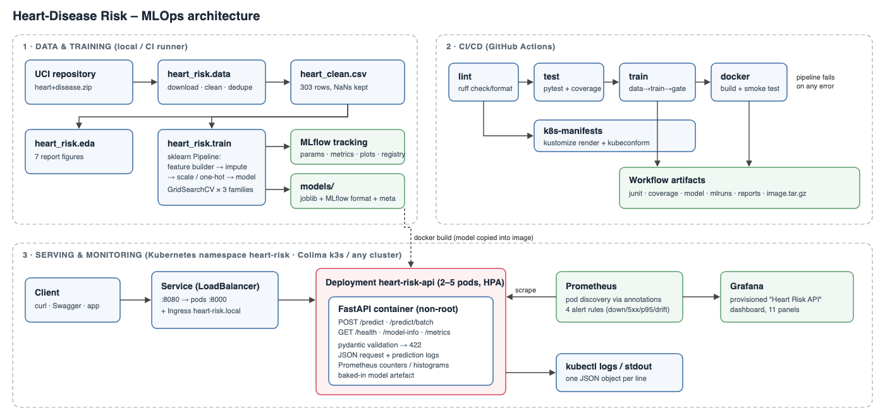{width=70%}

**Design choices that shaped the solution:**

* **One artefact holds all preprocessing.** Imputation, scaling, one-hot encoding and the engineered features all live inside a single scikit-learn `Pipeline`. The pickled model therefore takes raw UCI values and produces probabilities, so training, CI, notebooks and the API can't drift apart.
* **One configuration source.** Column lists, category codes and paths are defined once in `heart_risk/config.py`. Hyper-parameter grids are in `params.yaml`. The API schema, the cleaner and the tests all import the same definitions.
* **Model selection uses cross-validation only.** The 20 % hold-out set is touched once, to report an unbiased estimate. It is never used to choose a model.

# 2. Data acquisition and EDA

## 2.1 Acquisition

`python -m heart_risk.data` (also available as `scripts/download_data.sh` and `make data`) downloads the official UCI archive (`heart+disease.zip`, dataset id 45). It extracts the four `processed.*.data` files and writes `data/raw/`. It then writes the cleaned dataset to `data/processed/heart_clean.csv`. The download is skipped when the files already exist, so the step is idempotent.

## 2.2 Choosing the subset

The archive has four collection sites with the same 14-column layout. Figure 2 shows that only Cleveland is usable as is. The Hungarian, Swiss and VA files are missing 42–99 % of `ca` and `thal`, and the Swiss file has no cholesterol at all (stored as 0). Those features turn out to be among the strongest predictors. Pooling the sites would mean training mostly on imputed values and would add a site-level confound. **I therefore train on the 303 Cleveland patients.** Pooling is still one CLI flag away (`--sources cleveland hungarian …`).

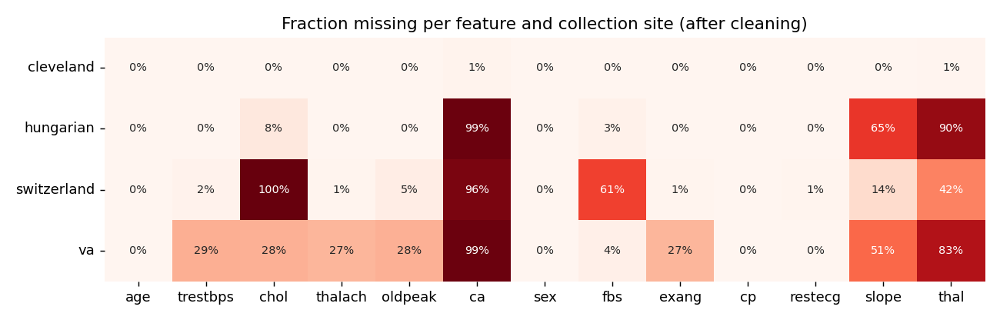{width=70%}

## 2.3 Cleaning

| Step | Rationale |
|---|---|
| `?` → NaN on read | UCI missing-value marker |
| `num` ∈ {0..4} → `target` = `num > 0` | The assignment asks for presence/absence. Severity levels 1–4 are sparse (13–55 patients each). |
| `chol ≤ 0`, `trestbps ≤ 0` → NaN | Physiologically impossible; these are disguised missing values in the other sites |
| Out-of-vocabulary codes (e.g. `thal ∉ {3,6,7}`, `ca ∉ [0,3]`) → NaN | Guards against corrupt rows |
| Drop exact duplicates | None in Cleveland, 2 in the pooled data |
| **No imputation here** | Imputation is learned inside the pipeline, so it is fitted on training folds only and ships with the model |

After cleaning, Cleveland has 4 missing `ca` and 2 missing `thal`. Everything else is complete.

## 2.4 Findings

The classes are close to balanced: 164 patients without disease (54 %) and 139 with (46 %). Accuracy is therefore a meaningful metric, but I also track recall and ROC-AUC because a missed diagnosis costs more than a false alarm.

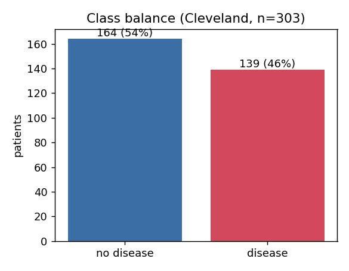{width=35%}

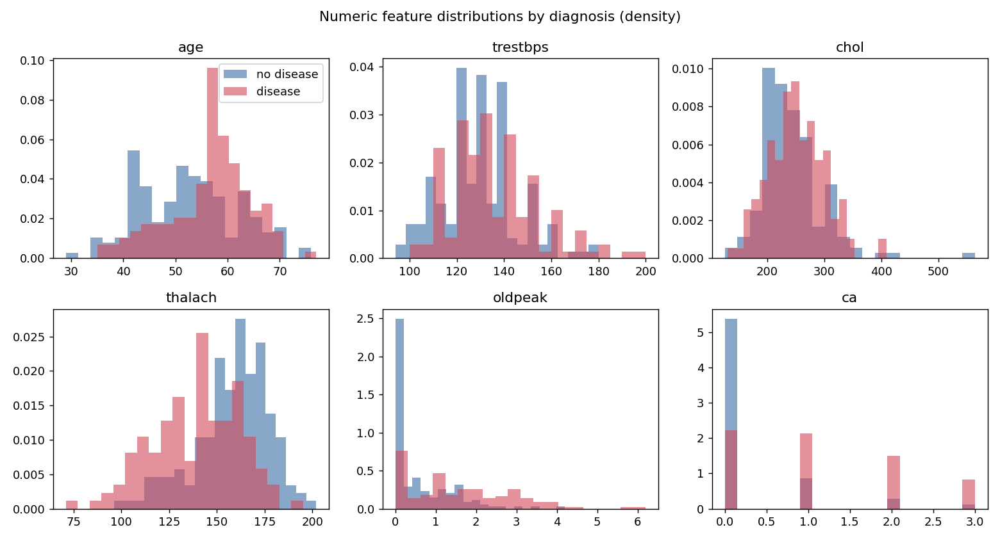{width=72%}

* **`thalach` (max heart rate)** is clearly lower in diseased patients, and **`oldpeak` (ST depression)** and **`ca`** are clearly higher. Cholesterol and resting blood pressure separate the classes only weakly. Their distributions overlap almost completely.
* Among the categorical features (Figure 5), asymptomatic chest pain (`cp=4`, 73 % prevalence), exercise-induced angina (77 %), a flat ST slope (65 %) and a reversible thallium defect (76 %) are the strongest indicators. Counter-intuitively, typical angina has a *lower* rate than asymptomatic pain. This is a well-known property of this cohort: patients were referred for angiography because of symptoms.
* `restecg=1` has only 4 patients. One-hot encoding keeps the level, but its coefficient is unreliable.

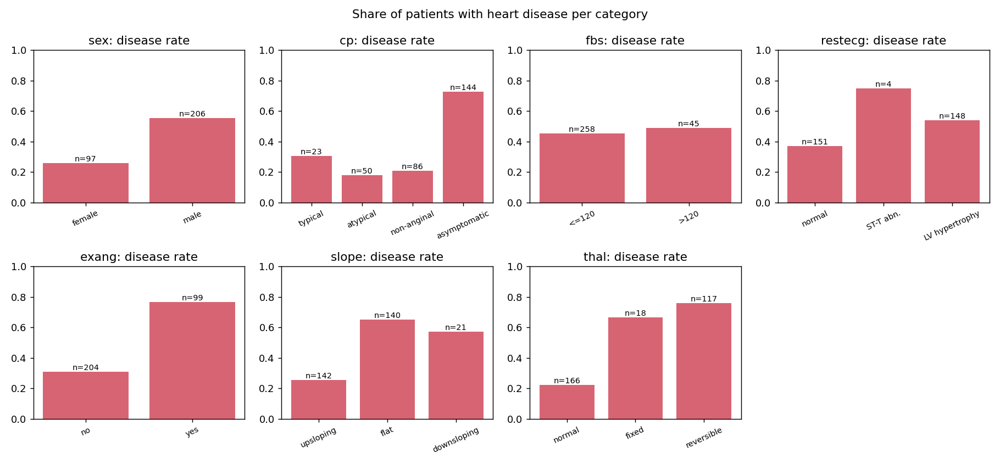{width=72%}

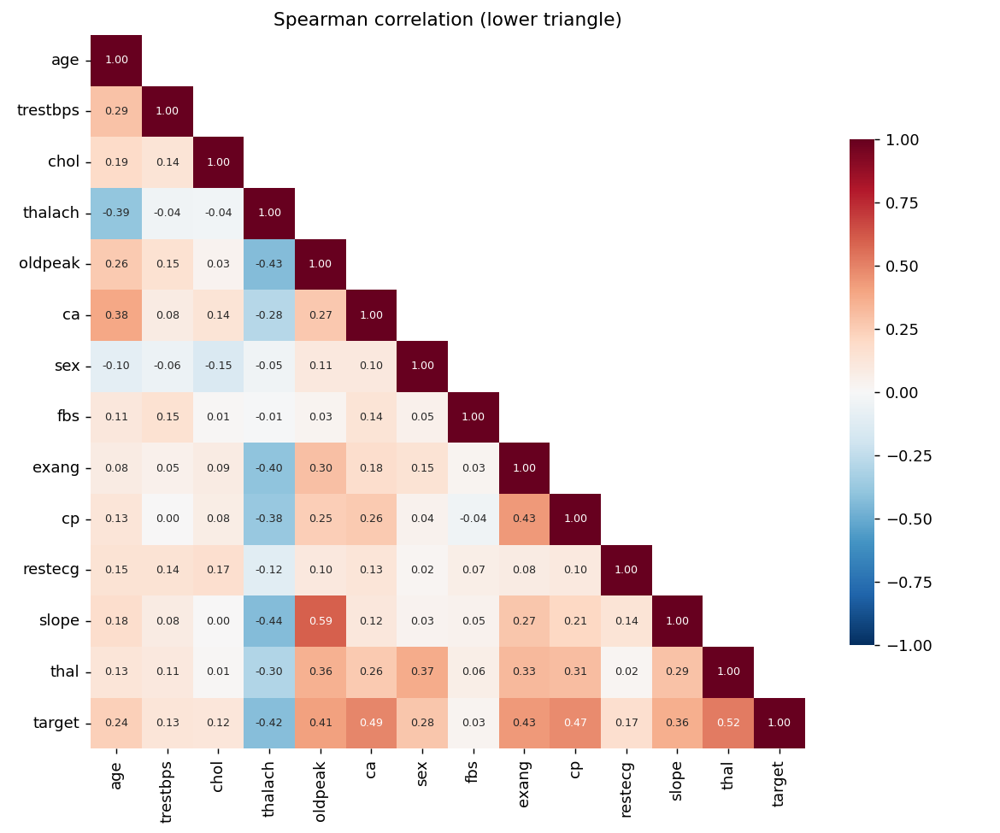{width=46%}

The correlation heatmap uses Spearman correlation because most variables are ordinal. It shows moderate collinearity between `slope` and `oldpeak` (0.6) and between `age` and `thalach` (−0.4). No pair is redundant enough to drop, and regularisation handles the rest. The features most correlated with the target are `thal`, `ca`, `cp`, `oldpeak`, `exang` and `thalach`, each with |ρ| ≈ 0.4–0.5.

# 3. Feature engineering and modelling

## 3.1 Feature pipeline

`heart_risk.features.build_pipeline(estimator)` builds this pipeline:

```
ClinicalFeatureBuilder ─► ColumnTransformer
                            ├─ numeric (6 + 2 engineered): median impute → StandardScaler
                            ├─ binary  (sex, fbs, exang):  most-frequent impute
                            └─ nominal (cp, restecg, slope, thal): most-frequent impute → OneHot
                          ─► estimator
```

That gives 24 model inputs. `OneHotEncoder` uses the *fixed* category list from the config, with `handle_unknown="ignore"`. The feature layout therefore never depends on which levels happen to appear in a training fold.

**Engineered features** (`ClinicalFeatureBuilder`):

* `hr_reserve_ratio = thalach / (220 − age)`. Max heart rate falls with age (Figure 7), so a raw `thalach` of 130 means something different at 40 than at 70. The ratio expresses achieved heart rate as a fraction of the age-predicted maximum. Values below about 0.85 (chronotropic incompetence) are a recognised marker of coronary disease.
* `age_chol_index = age × chol / 1000`. A crude cumulative-exposure interaction that a linear model can't build on its own.

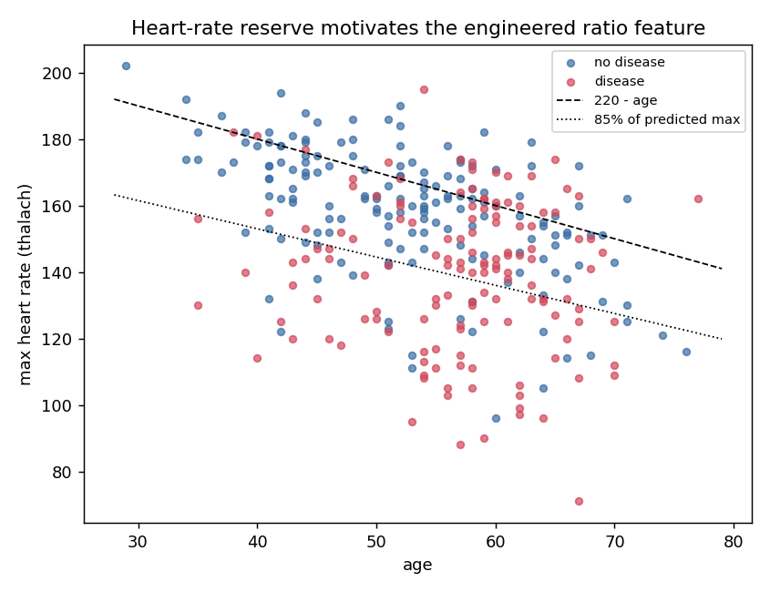{width=45%}

`ca` is treated as numeric because it is an ordinal count from 0 to 3. `cp`, `restecg`, `slope` and `thal` are one-hot encoded. Their codes are nominal: `thal` 3/6/7 is not an ordered scale.

## 3.2 Candidate models and tuning

`python -m heart_risk.train` makes a stratified 80/20 split (`random_state=42`) and then runs `GridSearchCV` with **stratified 5-fold CV** on the training part for three model families. The grids are defined in `params.yaml`:

| Model | Grid (points) | Why it's a candidate |
|---|---|---|
| Logistic Regression (liblinear) | C ∈ {0.01…10} × {L1, L2} × class_weight ∈ {none, balanced} (24) | Strong baseline for small tabular data. Calibrated probabilities. Interpretable. |
| Random Forest | n_estimators {200,400} × max_depth {None,4,6} × min_samples_leaf {1,3,5} × max_features {sqrt,0.5} (36) | Captures non-linearities and interactions. Robust to scaling. |
| Gradient Boosting | n_estimators {100,200} × lr {0.03,0.1} × depth {2,3} × subsample {0.8,1} (16) | Usually the strongest tabular learner |

Every grid point is scored on accuracy, precision, recall, F1 and ROC-AUC. **ROC-AUC is the refit and selection metric.** It doesn't depend on the threshold, and the threshold is a deployment decision (configurable through `DECISION_THRESHOLD`). The full `cv_results_` table for each model is logged to MLflow as `tuning/cv_results_<model>.csv`, so the tuning process can be audited.

## 3.3 Results

| Model | CV ROC-AUC | CV Accuracy | CV Precision | CV Recall | CV F1 | Hold-out ROC-AUC | Hold-out Acc. | Hold-out Recall |
|---|---|---|---|---|---|---|---|---|
| **Logistic Regression** | **0.906 ± 0.020** | **0.855** | **0.861** | **0.828** | **0.840** | **0.957** | 0.885 | **0.964** |
| Random Forest | 0.898 ± 0.028 | 0.826 | 0.852 | 0.765 | 0.799 | 0.953 | 0.885 | 0.929 |
| Gradient Boosting | 0.880 ± 0.026 | 0.802 | 0.802 | 0.774 | 0.781 | 0.949 | 0.885 | 0.893 |

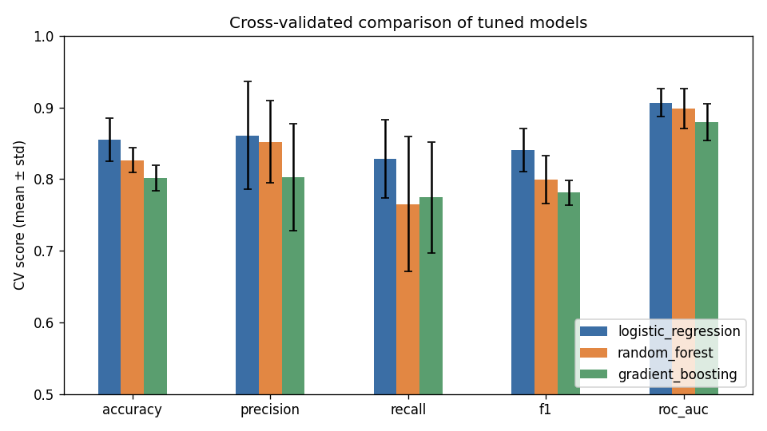{width=60%}

**Selected model: Logistic Regression, L2, C = 1.0, `class_weight="balanced"`.** It wins on every CV metric and has the lowest fold-to-fold variance. With 242 training rows, the extra capacity of the tree ensembles mostly fits noise. Note that RF's best configuration was its *most* regularised one (`min_samples_leaf=5`). Class balancing traded a little precision for recall, which is the right trade-off for a screening tool. On the untouched hold-out set, the model misses only 1 of 28 diseased patients (recall 0.96, precision 0.82).

Hold-out scores are higher than CV scores for all three models. With 61 test patients, one or two borderline cases move accuracy by 3 percentage points. The CV estimate of about 0.85 accuracy and 0.91 AUC is the figure I would quote.

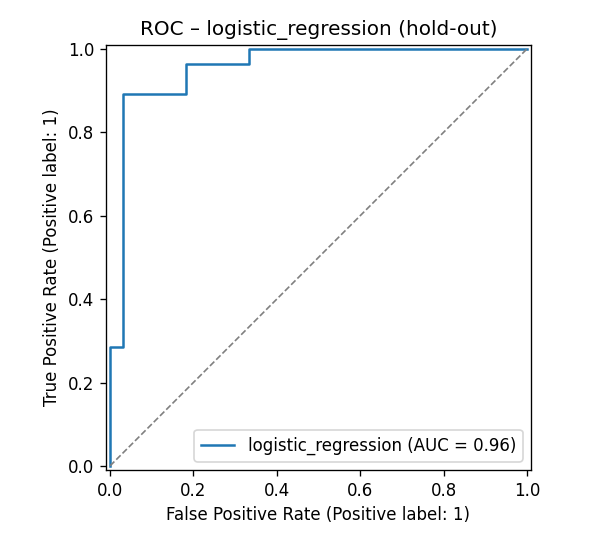{width=32%} 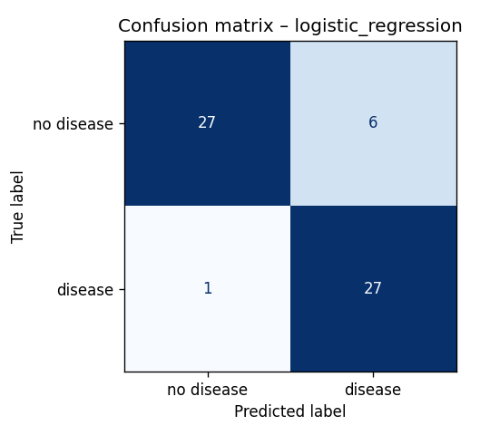{width=30%}

The largest standardised coefficients are `sex` (male, +1.14), `ca` (+1.09), `cp=asymptomatic` (+0.97), `exang` (+0.65) and `thal=reversible` (+0.63). Negative coefficients go to `cp` = non-anginal or typical, `thal=normal` and an upsloping ST segment. These match the EDA and clinical intuition, which is a useful sanity check that the model isn't keying on artefacts.

After selection, the winning configuration is **refit on all 303 rows** and saved as the shipped artefact.

# 4. Experiment tracking (MLflow)

Each training invocation creates four runs in the `heart-disease-risk` experiment: one per candidate family, plus a `final_<model>` run.

| Logged | Content |
|---|---|
| **Params** | Best hyper-parameters, grid size, CV folds, refit metric, train/test sizes |
| **Metrics** | `cv_*_mean` / `cv_*_std` for 5 metrics, `test_*` for 5 metrics, `fit_seconds` |
| **Tags** | `model_family`, `code_version`, `stage` (candidate / production-candidate), `selected_from` |
| **Artefacts** | `plots/` (ROC, confusion matrix, feature importance), `tuning/cv_results_*.csv`, `evaluation/classification_report.txt`, `comparison/` (table + bar chart), `model_meta.json` |
| **Model** | `mlflow.sklearn` model with an inferred signature and an input example. The final model is registered as **`heart-risk-classifier`** in the model registry, one new version per training run. |

The tracking URI defaults to `file:./mlruns`. Set `MLFLOW_TRACKING_URI` to point at a shared server. CI uploads the `mlruns/` folder as a workflow artefact, so every pipeline run's experiments can be downloaded and browsed with `mlflow ui`.

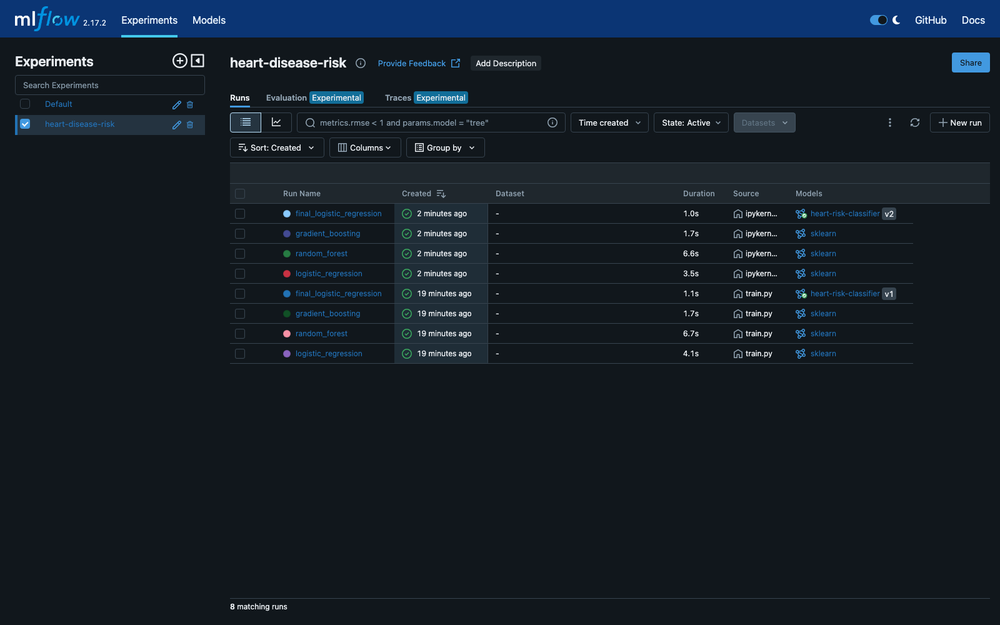{width=49%} 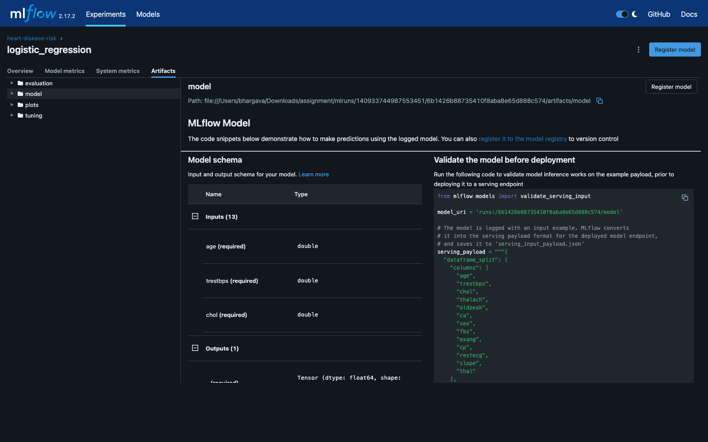{width=49%}

*Figure 10 (left) – MLflow experiment: candidate and final runs (two training invocations). Figure 11 (right) – Logged artefacts and model signature of the selected run.*

# 5. Packaging and reproducibility

* **Model formats:** `models/heart_risk_model.joblib` is what the API loads. `models/mlflow_model/` is the same pipeline in MLflow format, loadable with `mlflow.pyfunc.load_model`; notebook 03 shows both. The registry holds the versioned copy.
* **Model card:** `models/model_meta.json` records the model name and version, training timestamp, selection metric, best parameters, CV and hold-out metrics, the MLflow run id, the feature order and whether a quick grid was used. `GET /model-info` returns it.
* **Environments:** `requirements.txt` pins every direct dependency for training, notebooks and CI. `requirements-serve.txt` is a minimal subset for the container (no MLflow, Jupyter or plotting) with the *same* numpy, scipy, pandas and scikit-learn versions, so the pickle loads identically.
* **Determinism:** all randomness (split, CV shuffling, RF and GBM seeds) comes from `random_state: 42` in `params.yaml`. Re-running `make data train` reproduces the same metrics.
* **Clean-room check:** a fresh `venv` → `pip install -r requirements.txt` → `make data eda train test` is exactly the sequence the CI `train` job runs on a clean Ubuntu runner.

# 6. CI/CD and automated testing

## 6.1 Tests (`tests/`, 36 tests, about 1 s)

| File | Covers |
|---|---|
| `test_data.py` | `?` parsing, target binarisation, impossible values → NaN, duplicate removal, no input mutation, X/y split |
| `test_features.py` | Engineered feature values, preprocessor output width with no NaNs after imputation, standardisation, unknown categories handled |
| `test_model.py` | Pipeline learns signal, probability validity, joblib round-trip, estimator factory, importance extraction, inference with missing optional fields, risk bands, **quality gate** on the shipped artefact |
| `test_api.py` | `/health`, `/predict` response contract, request-id propagation, 422 on bad types, ranges, codes, unknown fields or missing fields, batch, `/metrics` content, degraded mode (503) without a model |

The tests use a synthetic fixture and never touch the network, so they are fast and hermetic. The API tests run the real FastAPI app through `TestClient` with a model trained on that fixture. Coverage across `src/` and `api/` is 55 %; the training and EDA entry points are exercised end to end by the CI `train` job instead.

## 6.2 Workflow (`.github/workflows/ci.yml`)

```
lint ──► test ──► train ──► docker
   └──► k8s-manifests
```

| Job | Steps | Artefacts |
|---|---|---|
| **lint** | `ruff check` (pyflakes, pycodestyle, isort, bugbear, pyupgrade, pep8-naming) and `ruff format --check` | GitHub annotations inline on the PR |
| **test** | `pip install -r requirements.txt` → `pytest` with coverage | `junit.xml`, `coverage.xml` |
| **train** | Download data → EDA → train (full grid on `main`, `--quick` on PRs) → **quality gate** (CV ROC-AUC ≥ 0.80 and feature contract) → markdown job summary of the comparison table | `model/`, `mlflow-runs/`, `training-reports/` (figures, CSV, log, cleaned data) |
| **docker** | Download the model artefact → `docker build` → `docker run` → wait for `/health` → POST the sample → assert the response contract → check `/metrics` → `docker logs` (always) → `docker save` | `docker-image` tarball |
| **k8s-manifests** | `kubectl kustomize k8s` → `kubeconform -strict` | — |

All steps run with `bash -e`. The pipeline fails and stops downstream jobs on any lint error, test failure, a regression below the quality bar, or a container that doesn't answer correctly. Step logs show exactly which check failed. `concurrency` cancels superseded runs on the same branch.

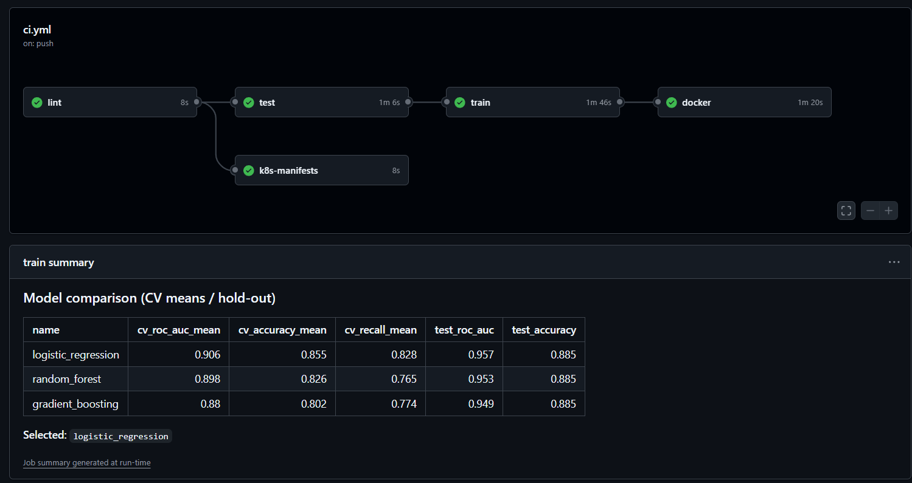{width=49%} 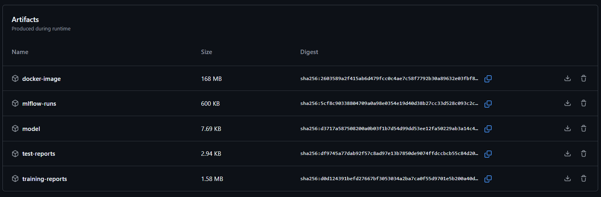{width=49%}

*Figure 12 (left) – Green GitHub Actions run (lint → test → train → docker, plus k8s-manifests) with the training job summary. Figure 13 (right) – Artefacts produced by the run: Docker image, MLflow runs, model, test and training reports.*

# 7. Containerisation and deployment

## 7.1 Container

The `Dockerfile` is a two-stage build on `python:3.11-slim`. The builder stage installs `requirements-serve.txt` into `/opt/venv`. The runtime stage copies only that venv, `src/`, `api/` and the two model files. The image runs as non-root UID 10001, has a `HEALTHCHECK` against `/health`, and starts `uvicorn` with a configurable worker count. Training data, tests and notebooks are excluded through `.dockerignore`.

**API contract.** `PatientFeatures` (pydantic) enforces types, physiological ranges (for example `trestbps` 50–250) and the allowed codes (`cp` ∈ {1,2,3,4}, …), and rejects unknown fields. `ca` and `thal` are optional, because they need fluoroscopy or a thallium scan that may not be available; the pipeline's imputers fill them. The response contains:

```json
{"prediction": 1, "label": "heart disease", "probability_disease": 0.9972,
 "confidence": 0.9972, "risk_band": "high",
 "model_name": "logistic_regression", "model_version": "1.0.0", "request_id": "1d1dec8a494f"}
```

`confidence` is the probability of the predicted class. `risk_band` buckets `probability_disease` into low (< 0.3), moderate (0.3–0.6) and high (≥ 0.6).

Local verification (`scripts/smoke_test.sh`, output in `screenshots/local_smoke_test.txt`): `/health` → ok; high-risk sample → 1 (p = 0.997); low-risk sample → 0 (p = 0.052); a batch of 3, one without `ca`/`thal`, succeeds; an invalid body → 422; `/metrics` shows the prediction counters.

{width=78%}

## 7.2 Kubernetes

The target is a local minikube cluster (Kubernetes v1.37, Docker driver) started with `minikube start --driver=docker --addons=ingress,metrics-server`. The `ingress` addon provides the NGINX ingress controller and `metrics-server` feeds CPU usage to the autoscaler. The manifests are plain YAML assembled with Kustomize (`kubectl apply -k k8s`) and work unchanged on Docker Desktop, minikube or a managed cloud cluster.

| Manifest | Highlights |
|---|---|
| `namespace.yaml` | Dedicated `heart-risk` namespace |
| `configmap.yaml` | `LOG_LEVEL`, `DECISION_THRESHOLD`, `WORKERS`: tunable without a rebuild |
| `deployment.yaml` | 2 replicas; rolling update with `maxUnavailable: 0`; readiness and liveness probes on `/health`; CPU/memory requests and limits; `runAsNonRoot`, `readOnlyRootFilesystem`, all capabilities dropped, seccomp `RuntimeDefault`; Prometheus scrape annotations |
| `service.yaml` | `type: LoadBalancer` on port 8080. `minikube tunnel` gives it an external IP (`127.0.0.1` on Windows, the service's cluster IP on Linux); on a cloud cluster it provisions a cloud LB. |
| `ingress.yaml` | Host `heart-risk.local` through the NGINX ingress controller (minikube `ingress` addon) |
| `hpa.yaml` | 2–5 replicas at 70 % CPU of the 100m request. Verified under load: CPU reached 113 % and the HPA scaled the API from 2 to 4 replicas (Figure 18). |
| `monitoring/` | Prometheus and Grafana (§8) |

`scripts/deploy_k8s.sh` (`make k8s-deploy`) builds the image, loads it into the cluster where needed (`minikube image load` here), applies everything, waits for the three rollouts and prints the endpoints. Keep `minikube tunnel` running in a separate terminal so the LoadBalancer services are reachable. On a Linux host, `scripts/run_linux.sh` runs every step interactively (tool install, venv, pipeline, Docker check, minikube deploy, port-forwarded access, smoke and load tests).

**Access instructions (local):**

* **Windows / macOS:** API at `http://localhost:8080/docs`, Prometheus at `:9090`, Grafana at `:3000` while `minikube tunnel` runs.
* **Linux:** the tunnel serves each LoadBalancer on its external IP, so use `kubectl -n heart-risk get svc` and browse to `http://<EXTERNAL-IP>:8080/docs` (`:9090`, `:3000` for the others), or run `./scripts/run_linux.sh access` to port-forward all three to `localhost`.
* **Ingress:** `curl -H "Host: heart-risk.local" http://$(minikube ip)/health`, or add `heart-risk.local` to the hosts file and open `http://heart-risk.local/docs`.

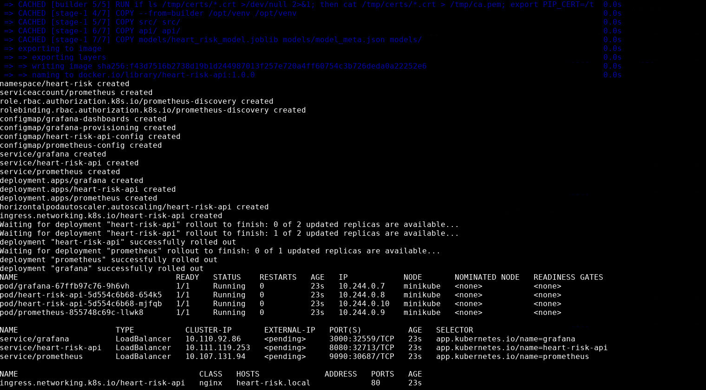{width=49%} 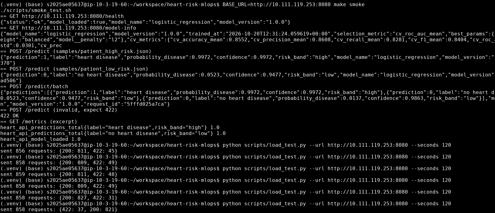{width=49%}

*Figure 15 (left) – `make k8s-deploy` on minikube: all resources created, three rollouts complete, 2 API pods plus Prometheus and Grafana running, nginx Ingress for `heart-risk.local`. Figure 16 (right) – Smoke test against the LoadBalancer (health, model-info, single and batch predictions, 422 on invalid input, metrics), followed by repeated two-minute load tests.*

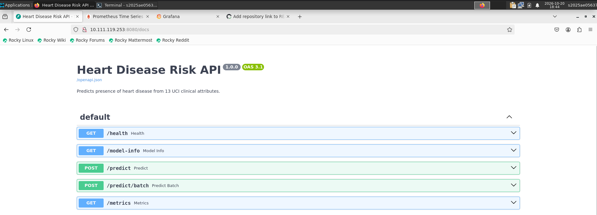{width=52%} 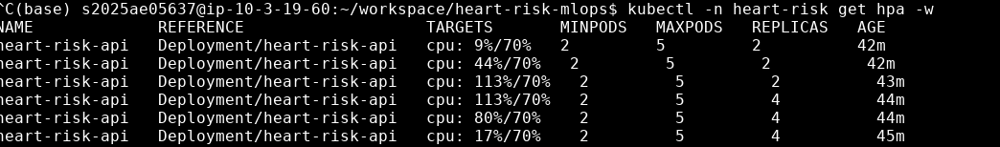{width=46%}

*Figure 17 (left) – Swagger UI served by the cluster through the LoadBalancer service. Figure 18 (right) – `kubectl get hpa -w` during load: CPU rises from 9 % to 113 % of the request and the HPA scales from 2 to 4 replicas, then CPU settles back to 17 %.*

# 8. Monitoring and logging

**Logging.** The API writes one JSON object per line to stdout, ready for Loki, ELK or CloudWatch without parsing rules. Each request produces a `request` record (request id, method, route template, status, latency in ms, client IP). Each scored patient produces a `prediction` record with the inputs and the output, which forms an audit trail and a ready-made dataset for drift analysis. The request id is taken from `X-Request-ID` when the caller sends one, otherwise generated, and is echoed back in the header and the body. View the logs with `kubectl -n heart-risk logs -l app.kubernetes.io/name=heart-risk-api`.

**Metrics** (`/metrics`):

| Metric | Type | Use |
|---|---|---|
| `heart_api_requests_total{method,path,status}` | counter | Traffic and error rate |
| `heart_api_request_latency_seconds{path}` | histogram | p50, p95 and p99 latency |
| `heart_api_predictions_total{label,risk_band}` | counter | Output mix |
| `heart_api_predicted_probability` | histogram | **Model-output drift:** compare the live distribution with training |
| `heart_api_model_loaded`, `heart_api_model_info{model_name,model_version}` | gauge | Which model each pod serves |

**Prometheus** discovers each API *pod* through its annotations, so per-replica health is visible. It evaluates four alert rules: `HeartApiDown`, `HeartApiHighErrorRate` (> 5 % 5xx), `HeartApiSlowP95` (> 250 ms) and `HeartApiPredictionDrift` (positive share > 80 % against a training prior of 46 %).

**Grafana** has its datasource and the **Heart Risk API** dashboard (11 panels) provisioned from code. Panels: healthy replicas, request rate, total predictions, p95 latency, 5xx ratio, positive share, request rate by endpoint and status, latency percentiles, predictions by risk band, predicted-probability distribution, and requests per pod. `scripts/load_test.py` sends a realistic mix of traffic (single requests, batches and about 5 % invalid requests) to populate the dashboard.

{width=68%}

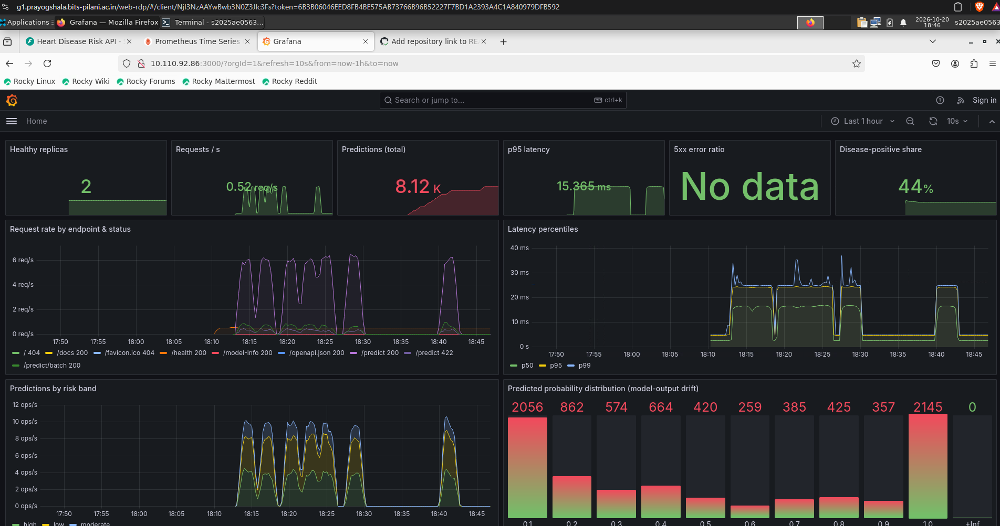{width=78%}

# 9. Reflections and next steps

* **Limitations.** 303 patients from a single centre in 1988 is a very small, dated cohort. The model should be treated as a teaching artefact, not a clinical tool. The `sex` coefficient reflects the cohort's composition as much as physiology.
* **Threshold.** The threshold is exposed as configuration because the right operating point depends on the clinical use. A screening tool would lower it to push recall higher still.
* **Next steps.** Push the image to a registry and add a CD job that deploys to a cloud cluster; use a shared MLflow server with registry stage transitions as the promotion gate; add calibration (Platt or isotonic) and SHAP explanations in the API response; build a scheduled drift job that compares logged inputs with the training distribution (PSI or KS) and triggers retraining.

# Appendix A — Reproduce everything

```bash
python3.11 -m venv .venv && source .venv/bin/activate && pip install -r requirements.txt
make data eda train test lint          # data -> figures -> MLflow runs + models/ -> 36 tests
make docker-build docker-run           # in another shell: make smoke
make k8s-deploy && BASE_URL=http://localhost:8080 make smoke && make load
./scripts/run_linux.sh                # Linux: interactive menu for all of the above
make mlflow-ui                         # http://localhost:5000
```
